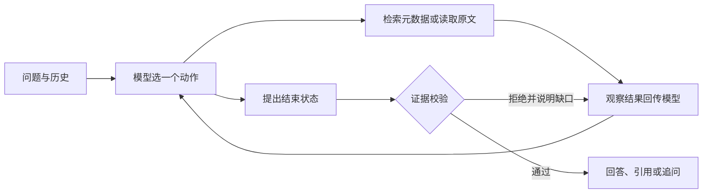

# 02 方案与取舍

## 模型动作与工具闭环

`src/cli.py` 读取输入；`src/models.py` 让 DeepSeek 在 `search_documents`、`read_snippet`、`finish` 中每轮选一个动作；`src/agent.py` 执行并把工具观察回传模型，再由模型选择下一步。`finish` 是受校验的结束动作，证据不足时返回拒绝原因给模型继续决策。多工具并行请求先被拒绝，避免跳过检索和读取依赖。`--max-steps` 与 `--max-tools` 防止无界循环。

## 检索与引用

合成资料的 `aliases` 覆盖“报销/报账/花完钱”等改写，检索前做 Unicode 归一化和大小写归一化。当前问题先确定目标主题；若当前句省略主题，再从最近的用户历史消息补足。搜索只返回文档 ID、标题、版本日期和片段 ID；必须再调用 `read_snippet` 才能取得原文。引用直接取已读取的原文，并附源文本哈希；输出文本由程序从这些引用构造，不接受模型自由编造的引文。

## 冲突和安全边界

结束校验要求相关文档均已检索、相关片段均已读取。报销期限从**原文**抽取天数；若不同，模型提出单一答案会得到 `unresolved_document_conflict`，需改为列出冲突和追问适用范围。版本日期只用于引用，不自动表示新版本覆盖旧版本。资料外问题或所问细节在原文中缺失时返回 `insufficient`；例如“报销多久到账”不能用“报销提交期限”作答。未成功读取的片段不能进入 `citations`。

## 技术取舍与局限

原生 Python 标准库、CLI 和本地 JSON 资料足以清楚展示模型决策与证据校验，不引入框架。DeepSeek Chat Completions function calling 负责真实动作选择；离线 Mock 是明示的规则策略，仅验证流程。检索是适合小型合成语料的别名映射；冲突识别专门覆盖报销期限数字冲突，并不理解所有制度中的隐含逻辑、优先级或复杂适用范围。生产系统需要更完整的检索、权限、版本关系和人工复核。
